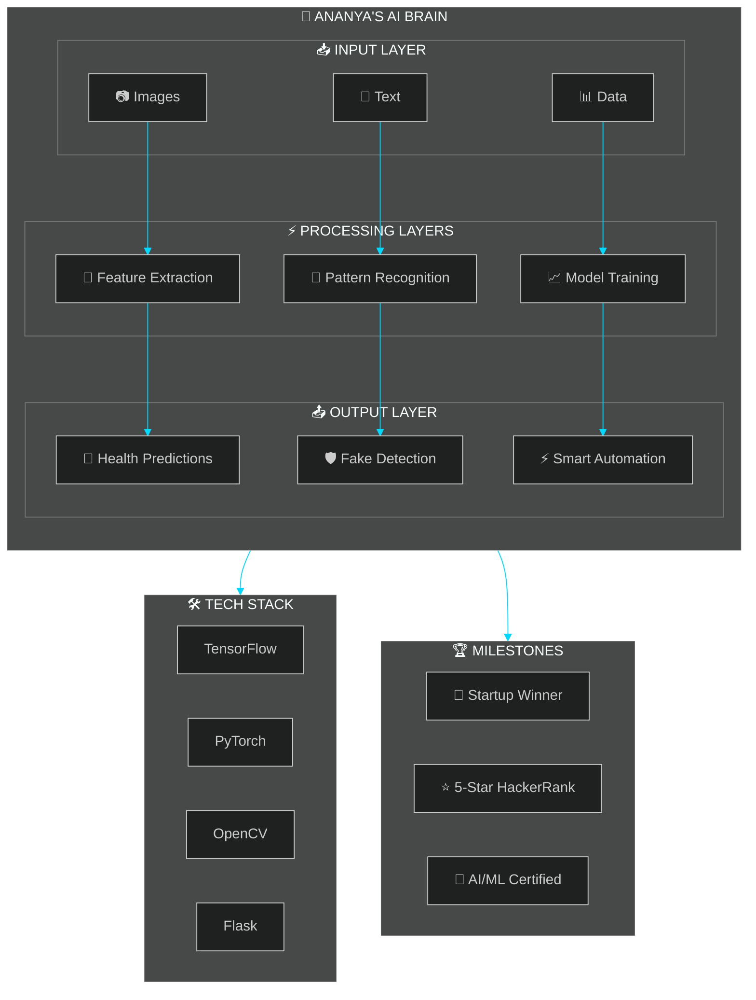

<!-- Animated Header -->

  

<!-- Social Badges -->

  
  
  

---

<!-- About Me Section with Aesthetic Design -->

## ⚡ The Story Behind The Code

🎓 **B.Tech Computer Science (AI & ML)** @ Kalinga University  
📊 **CGPA:** 8.6/10 ⭐ | 📅 2023-2027  
📍 **Location:** India 🇮🇳

### 🚀 What I'm Building:
- 🔬 **SymptomIQ** - AI-powered health prediction system
- 🛡️ **DeepFake Detector** - Fighting misinformation with deep learning
- ⚡ **Power Monitor** - Award-winning energy optimization with CV
- 📊 **Data Solutions** - Turning raw data into actionable insights

### 💡 My Motto:
> *"If AI had dreams, mine would be written in Python 🐍"*

 

---

## 🏆 Achievement Spotlight

  

<table align="center">
  <tr>
    <td align="center">
      
       <strong>Startup Competition</strong>
       <em>1st Place Winner</em>
       Automated Power Monitoring System
    </td>
    <td align="center">
      
       <strong>HackerRank</strong>
       <em>5-Star Rating</em>
       C Programming
    </td>
    <td align="center">
      
       <strong>Certified</strong>
       <em>AI & Machine Learning</em>
       Teach Nook
    </td>
    <td align="center">
      
       <strong>HackerRank SQL</strong>
       <em>Certified</em>
       Database Expert
    </td>
  </tr>
</table>

---

## 🚀 Featured Projects

<table>
<tr>
<td width="50%">

### 🏥 SymptomIQ
**AI-Powered Health Prediction System**

- 🧠 Predicts health conditions using ML
- 📍 Geolocation-based doctor recommendations  
- 💬 Personalized advice via Google Gemini API
- 🌐 Full-stack Flask web application

</td>
<td width="50%">

### 🛡️ DeepFake Detector
**AI Security Tool for Image Authenticity**

- 🔍 Detects FAKE vs REAL images
- 📊 Interactive probability visualization
- 🎨 Modern frontend with animations
- 🚀 High-accuracy ML classification

</td>
</tr>
<tr>
<td width="50%">

### ⚡ Power Monitor System
**🏆 Award-Winning Energy Optimization**

- 👁️ Real-time human presence detection
- ⚡ Automated appliance control
- 🏆 **1st Place - Startup Competition**
- 🌱 Energy efficiency optimization

</td>
<td width="50%">

### 🎓 Student DBMS
**Comprehensive Management System**

- 🔐 Secure login authentication
- 📊 Complete CRUD operations
- 🎨 User-friendly Tkinter GUI
- 💾 MySQL database integration

</td>
</tr>
</table>

---

## 🛠️ Tech Arsenal

### 💻 Languages & Databases

### 🤖 AI/ML & Data Science

### 🧰 Frameworks & Tools

### ⚙️ Development Environment

---

## 📊 GitHub Analytics

  
  

  

---

## 🧠 AI/ML Journey Visualization

### 🔮 The Neural Network of My Skills

| Layer | Components | Purpose |
|:-----:|:-----------|:--------|
| 🎯 **Input** | Images, Text, Structured Data | Data Collection & Preprocessing |
| ⚙️ **Hidden** | TensorFlow, PyTorch, Scikit-Learn | Feature Extraction & Learning |
| 🚀 **Output** | Predictions, Classifications, Insights | Real-World Solutions |

---

## 🌐 Interactive Profile Map

  

 

  
  

 

  
  

---

## 📈 Activity Graph

  

---

## 🎯 Current Focus

```mermaid
mindmap
  root((🧠 Ananya's AI Journey))
    🤖 AI/ML
      Deep Learning
      Neural Networks
      Model Optimization
    🗣️ NLP
      Transformers
      Text Analysis
      Sentiment Analysis
    👁️ Computer Vision
      Object Detection
      Image Classification
      DeepFake Detection
    📊 Data Science
      Data Analysis
      Visualization
      Feature Engineering
```

---

## 💡 My Philosophy

  
| 🎯 Approach | 📝 Description |
|------------|----------------|
| **Learn** | Embrace every challenge as a learning opportunity |
| **Build** | Transform concepts into real-world applications |
| **Fail** | View failures as stepping stones to success |
| **Improve** | Commit to 1% daily growth |
| **Repeat** | Consistency beats perfection |

> *"The best way to predict the future is to create it with AI"* 🚀

---

## 🤝 Let's Connect & Collaborate

 

  

---

<!-- Cool Footer -->

  

  <strong>⭐ From <a href="https://github.com/Ananya419">Ananya Shahi</a> with 💖</strong>
   
  <em>Turning ideas into code & dreams into AI-driven solutions</em>

